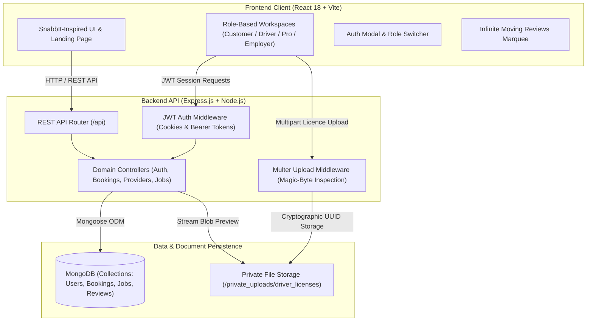
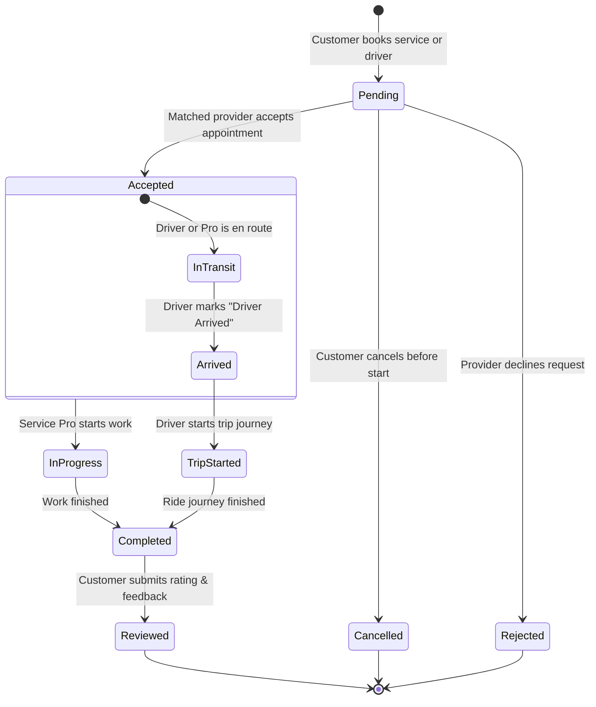
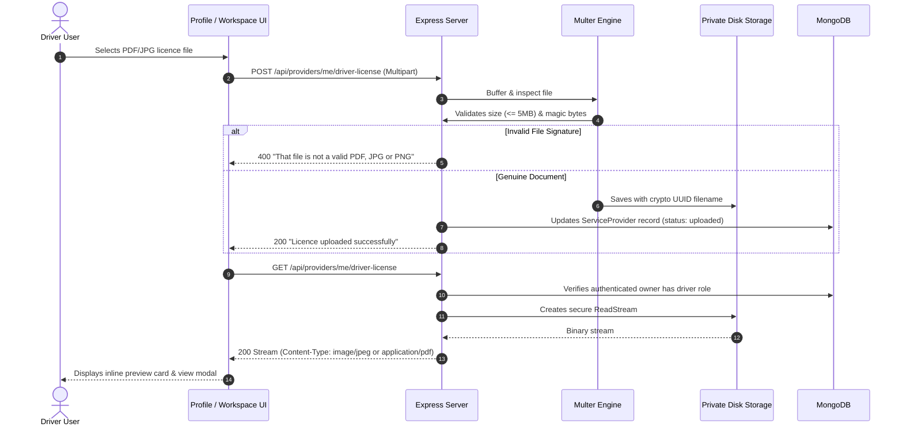
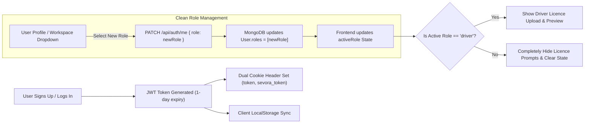
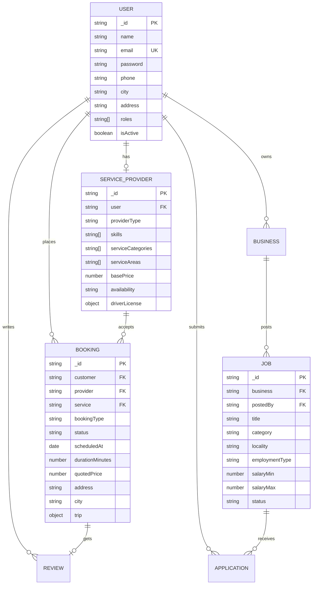

# Sevora (सेवोरा) — Hyperlocal Services, Driver Hires & Community Work Marketplace

<div align="center">


**A professional, full-stack MERN on-demand service marketplace heavily inspired by SnabbIt and UrbanClap.**  
*Bridging local households with verified professionals, personal drivers, and neighborhood job opportunities across Punjab, Chandigarh, and Haryana.*

</div>

---

## 🌟 Overview & Design Philosophy

**Sevora** brings everyday neighborhood help and verified trade professionals to your doorstep. Inspired by the clean, friendly, photo-forward aesthetic of **SnabbIt** and the operational robustness of **UrbanClap**, Sevora features:

* **Signature Blush Pink Design System**: Warm pastel tones (`#ef438b`, `#fff0f6`), smooth curves, accessible typography, and mobile-first responsiveness.
* **Dual-Track Moving Reviews Carousel**: SnabbIt-style auto-scrolling customer testimonials with bidirectional marquee animation and pause-on-hover.
* **4-in-1 Role Workspaces**: Instantly switch between **Customer**, **Personal Driver**, **Service Professional**, and **Employer / Recruiter** workspaces without re-registering.
* **Strict Role-Gated Driver Licence Pipeline**: Multer-backed document upload with magic-byte verification and private streaming preview—strictly visible only to verified drivers.
* **Real-time Appointment Lifecycle**: From matching and acceptance to driver arrival, job execution, live phone contact, and 5-star customer reviews.
* **Regional Hyperlocal Coverage**: Preconfigured for Tricity and Punjab/Haryana cities (Rajpura, Chandigarh, Mohali, Panchkula, Patiala, Ambala, Ludhiana, Jalandhar, Amritsar, Bathinda, and more).

---

## 🏗️ System Architecture



---

## 👥 The 4 Role-Based Workspaces

| Role | Target Persona | Capabilities & Workspaces |
| :--- | :--- | :--- |
| **Customer** | Households, individuals & commuters | Browse service catalogue, book home repairs/maid/cooking, arrange on-demand personal car drivers, track live bookings, view matched provider phone numbers, and submit star reviews. |
| **Driver** | Professional personal drivers | Accept trip bookings, configure manual/automatic transmission skills, upload driving licence via Multer, stream document preview, and advance trip states (*Driver Arrived*, *Trip Started*, *Completed*). |
| **Service Pro** | Electricians, plumbers, cleaners, cooks | Manage service profile, set base hourly/service rates, select service categories and cities, accept/decline customer appointments, and apply to local jobs. |
| **Employer** | Local businesses, shop owners, recruiters | Register verified business entities, post job vacancies with salary brackets, review incoming candidate applications, and shortlist or hire talent. |

---

## 🔄 Core Workflows & Logic

### 1. Booking Appointment Lifecycle



---

### 2. Multer Driver Licence Upload & Streaming Pipeline

Driving licences are sensitive documents and are **never exposed via public static directories**. They are uploaded via Multer to a private filesystem directory, validated for genuine binary magic bytes (PDF `%PDF`, JPEG `\xFF\xD8\xFF`, PNG `\x89PNG`), and securely streamed inline only to the authorized driver owner.



---

### 3. Dynamic Role Switching & JWT Cookie Synchronization



---

## 📁 Repository Structure

```text
sevora/
├── backend/
│   ├── private_uploads/
│   │   └── driver_licenses/      # Secure disk storage for licence documents
│   ├── src/
│   │   ├── controllers/
│   │   │   ├── authController.js        # Register, login, updateMe, cookies
│   │   │   ├── bookingController.js     # Booking creation, matching, status
│   │   │   ├── providerController.js    # Provider profiles & Multer licence stream
│   │   │   ├── jobController.js         # Employer jobs & vacancies
│   │   │   ├── applicationController.js # Job candidate submissions
│   │   │   ├── businessController.js    # Employer business profiles
│   │   │   ├── reviewController.js      # Star ratings & customer reviews
│   │   │   ├── serviceController.js     # Home service catalogue items
│   │   │   └── serviceRequestController.js # Custom community bids
│   │   ├── middleware/
│   │   │   ├── authMiddleware.js        # JWT token & role authorization
│   │   │   └── uploadDriverLicense.js   # Multer storage & magic-byte inspector
│   │   ├── models/
│   │   │   ├── User.js                  # User credentials & primary roles
│   │   │   ├── ServiceProvider.js       # Trade skills & driver licence schema
│   │   │   ├── Booking.js               # Service & trip appointments
│   │   │   ├── Job.js                   # Employer job postings
│   │   │   ├── Application.js           # Candidate job applications
│   │   │   ├── Business.js              # Business profiles
│   │   │   ├── Service.js               # Catalogue definitions
│   │   │   ├── ServiceRequest.js        # Custom customer requests
│   │   │   └── Review.js                # Ratings & review comments
│   │   ├── app.js                       # Express app configuration & routes
│   │   ├── server.js                    # Server startup & DB connection
│   │   └── seedDemoData.js              # Initial database seeder
│   ├── package.json
│   └── .env
│
├── frontend/
│   ├── src/
│   │   ├── App.jsx                      # Main landing page & master layout
│   │   ├── ProfilePage.jsx              # Personal profile & driving licence card
│   │   ├── RoleDashboard.jsx            # Role-specific workspaces (4 personas)
│   │   ├── ReviewsCarousel.jsx          # SnabbIt-style moving reviews marquee
│   │   ├── AuthModal.jsx                # Login / signup with role selection
│   │   ├── data.js                      # Cities, categories, and fallback catalogue
│   │   ├── index.css                    # Design system, marquee animations, pink theme
│   │   └── role-dashboard.css           # Workspace panel, stats, and item card styles
│   ├── package.json
│   ├── vite.config.js
│   └── .env
└── README.md
```

---

## 🗄️ Database Schema (Entity Relationship)



---

## 🚀 Getting Started

### Prerequisites
* **Node.js**: v18.0.0 or higher
* **MongoDB**: Local MongoDB instance running on `mongodb://127.0.0.1:27017` or a MongoDB Atlas URI

---

### Step 1: Clone & Configure Backend

```powershell
# Navigate to backend directory
cd backend

# Install dependencies
npm install

# Create environment file (.env)
New-Item -ItemType File -Name .env -Force
```

Add the following to `backend/.env`:
```env
PORT=5000
MONGODB_URI=mongodb://127.0.0.1:27017/sevora
JWT_SECRET=sevora_super_secret_jwt_key_2026_production
CLIENT_URL=http://localhost:5173
```

Seed initial services and demo professionals:
```powershell
node src/seedDemoData.js
```

Start the backend server:
```powershell
npm start
# Server runs at http://localhost:5000
```

---

### Step 2: Configure & Launch Frontend

Open a new terminal window:

```powershell
# Navigate to frontend directory
cd frontend

# Install dependencies
npm install

# Create environment file (.env)
New-Item -ItemType File -Name .env -Force
```

Add the following to `frontend/.env`:
```env
VITE_API_URL=http://localhost:5000/api
```

Start the Vite development server:
```powershell
npm run dev
# Frontend runs at http://localhost:5173
```

---

## 🔌 API Endpoints Reference

### Authentication & User Profile
| Method | Endpoint | Access | Description |
| :--- | :--- | :--- | :--- |
| `POST` | `/api/auth/register` | Public | Register new account with role (`customer`, `driver`, `provider`, `employer`). Sets JWT cookies. |
| `POST` | `/api/auth/login` | Public | Authenticate user, returning JWT token and dual cookies (`token`, `sevora_token`). |
| `GET` | `/api/auth/me` | Protected | Fetch currently authenticated user credentials, active role, and address. |
| `PATCH` | `/api/auth/me` | Protected | Update profile information and seamlessly switch active role. |
| `PATCH` | `/api/auth/password` | Protected | Change account password with current password verification. |

### Driver Licences & Service Providers
| Method | Endpoint | Access | Description |
| :--- | :--- | :--- | :--- |
| `GET` | `/api/providers/me` | Protected (Driver/Pro) | Fetch worker profile, availability, trade skills, and licence record. |
| `POST` | `/api/providers/me` | Protected (Driver/Pro) | Create or update worker skills, categories, pricing, and availability. |
| `POST` | `/api/providers/me/driver-license` | Protected (Driver only) | Upload driving licence file via Multer with magic-byte verification. |
| `GET` | `/api/providers/me/driver-license` | Protected (Driver only) | Stream saved driving licence file inline to the owner. |

### Bookings & Rides
| Method | Endpoint | Access | Description |
| :--- | :--- | :--- | :--- |
| `GET` | `/api/bookings/my` | Protected | Get bookings associated with the current user (as customer or provider). |
| `POST` | `/api/bookings` | Protected | Book a home service or personal driver with automated provider matching. |
| `PATCH` | `/api/bookings/:id/status`| Protected | Update booking status (`accepted`, `driver_arrived`, `in_progress`, `completed`, `cancelled`). |

### Jobs & Applications (Employer Workspace)
| Method | Endpoint | Access | Description |
| :--- | :--- | :--- | :--- |
| `GET` | `/api/jobs` | Public | Search open job vacancies by city, category, or search term. |
| `POST` | `/api/jobs` | Protected (Employer) | Post a new job vacancy under a registered business. |
| `GET` | `/api/jobs/my` | Protected (Employer) | List vacancies posted by the current employer. |
| `POST` | `/api/applications` | Protected | Submit application for an open position with cover letter. |
| `GET` | `/api/applications/my` | Protected | Track submitted job applications and candidate status. |
| `GET` | `/api/applications/received` | Protected (Employer) | Review applicant submissions for employer's posted jobs. |
| `PATCH`| `/api/applications/:id/status`| Protected (Employer)| Mark applicant as `shortlisted`, `rejected`, or `hired`. |

### Customer Reviews & Ratings
| Method | Endpoint | Access | Description |
| :--- | :--- | :--- | :--- |
| `POST` | `/api/reviews` | Protected (Customer) | Submit star rating (1–5) and review comment for completed bookings. |
| `GET` | `/api/reviews/provider/:id` | Public | View verified customer reviews and aggregate ratings for a professional. |

---

## 🎨 UI Features Inspired by SnabbIt

* **Pink / Blush Contemporary Palette**: High visual hierarchy, rounded card aesthetics, soft dropshadows, and pill tags.
* **Continuous Testimonial Marquee**: Dual horizontal moving tracks showcasing authentic reviews from Rajpura, Chandigarh, Mohali, and Patiala with instant hover-freeze.
* **Instant Back-To-Home Navigation**: Never get stuck on profile or workspace panels; dedicated `← Back to Home` and brand mark links return seamlessly to the storefront.
* **Live In-Header City Selector**: Dynamically filter available services, jobs, and requests across 12+ northern regional hubs.

---

## 🧪 Testing & Verification

A dedicated verification test suite is included in `backend/scripts/`:

```powershell
# Run complete MERN flow verification
node backend/scripts/test_mern_flow.js
```

This verifies:
1. Customer registration & JWT token generation.
2. Service catalogue query and provider matching.
3. Conflict-free booking creation & state transitions.
4. Multer driver licence upload and magic-byte security.
5. Strict role gating (customers cannot see or access driver endpoints).
6. 5-star customer review submission and aggregation.

---

## 📄 License

This project is licensed under the MIT License. Built with passion for local communities.
